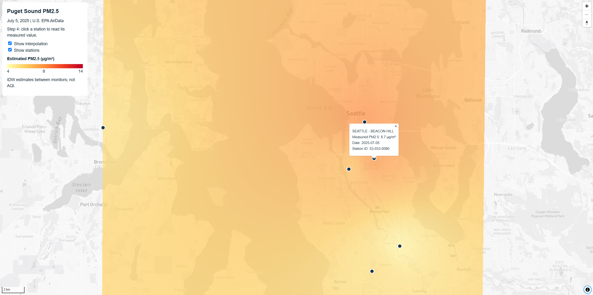
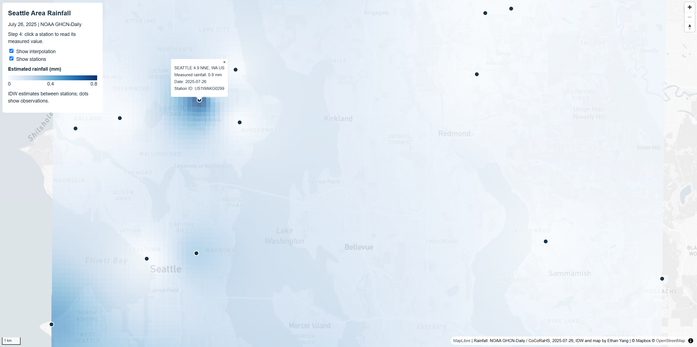

# Lab 3: Basemap Design and Tile Generation

Ethan Yang | GEOG 458

- [Guided map: PM2.5](https://ysk0112-e3n.github.io/geog458-labs/lab3/ethanyang_lab3-1.html)
- [Independent map: Rainfall](https://ysk0112-e3n.github.io/geog458-labs/lab3/ethanyang_lab3-2.html)
- [Repository](https://github.com/ysk0112-e3n/geog458-labs)

**Purpose:** Compare station measurements with estimated surfaces. Each map: Studio basemap + IDW raster + clickable stations.
**Audience:** Students and residents exploring local air quality and summer rainfall patterns.

## Guided: PM2.5

- Puget Sound, 2025-07-05, 11 stations (4.1–12.1 µg/m³)
- Data: [EPA AirData](https://www.epa.gov/outdoor-air-quality-data)
- IDW on `pm25`, EPSG:32610, power 2, 250 m
- Basemap: Mapbox Light, POIs filtered

## Independent: Rainfall

- Seattle area, 2025-07-26, 21 CoCoRaHS stations (0–0.8 mm)
- Data: [NOAA CDO](https://www.ncei.noaa.gov/cdo-web/search) Daily Summaries
- Filter: map bounds, valid non-trace `PRCP`, zeros kept
- IDW on `PRCP`, EPSG:32610, power 2, 250 m
- Basemap: guided style, gray-blue water
- Surface = estimated rainfall; points = gauge readings

## Tiles

XYZ PNG, EPSG:3857, 256 px, zoom 8–12. Thematic tiles transparent.

| Folder | Bounds |
| --- | --- |
| `mapbox-guided/`, `pm25-guided/` | 122.75–122.05°W, 47.10–48.15°N |
| `mapbox-independent/`, `rainfall-independent/` | 122.45–121.95°W, 47.50–47.80°N |

## Limits

- Popups = measured; colors = IDW estimates
- Less reliable far from stations
- PM2.5 ≠ AQI; rainfall = one day only

## Screenshots

